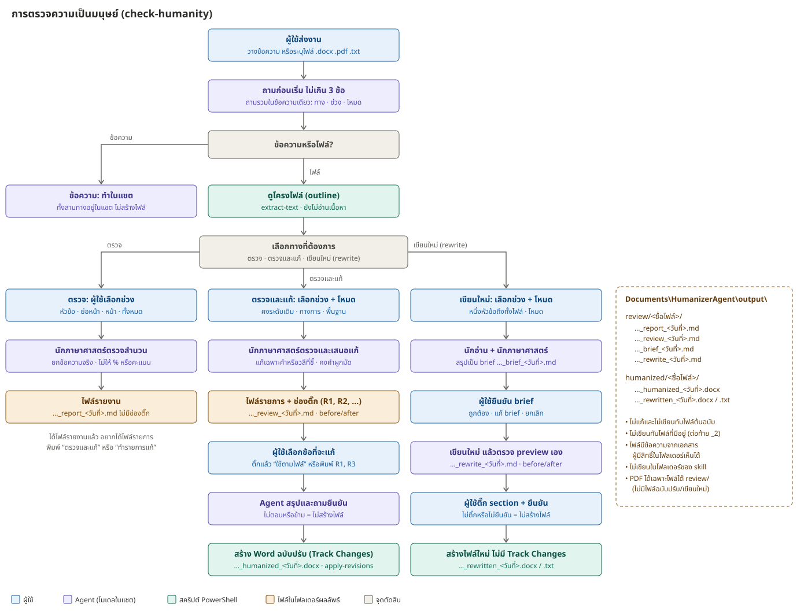

# HumanizerAgent: ตรวจความเป็นมนุษย์ (check-humanity)

skill สำหรับ Codex และ Claude Code ที่ช่วยตรวจและปรับความเป็นธรรมชาติของสำนวนไทย อังกฤษ และข้อความผสม จากข้อความที่วางในแชตหรือจากไฟล์ Word, PDF, txt ผลเป็นการประเมินสำนวนพร้อมเหตุผล ไม่ใช่การตัดสินว่าใครหรือ AI เป็นผู้เขียน และไม่ให้เปอร์เซ็นต์ความเป็นมนุษย์

## สิ่งที่ต้องมี

- Windows ที่มี Windows PowerShell (มากับเครื่องอยู่แล้ว) skill อ่านและสร้างไฟล์ด้วยสคริปต์ PowerShell
- Node.js (เวอร์ชัน LTS ล่าสุดก็พอ) เพื่อใช้คำสั่ง `npx` ติดตั้ง
- เชื่อมต่ออินเทอร์เน็ตถึง GitHub ได้ (ชุดนี้อยู่ที่ https://github.com/Babybewz/Humanizer-Agent เป็น repo สาธารณะ ไม่ต้องล็อกอิน)
- Codex หรือ Claude Code อย่างใดอย่างหนึ่งหรือทั้งสองอย่าง
- PDF: ไม่ต้องติดตั้งอะไรเพิ่ม ถ้าเครื่องมีตัวอ่าน PDF (`pdftotext`) สคริปต์จะใช้ ถ้าไม่มี ผู้ช่วยจะอ่าน PDF ด้วยเครื่องมือของโปรแกรม AI เอง (เช่น Claude Code) ถ้ายังอ่านไม่ได้ ให้บันทึก PDF เป็น `.docx` หรือคัดลอกข้อความมาวาง

## ติดตั้ง

ติดตั้งแบบระดับผู้ใช้ ติดตั้งครั้งเดียวแล้วใช้ได้ในทุกโปรเจกต์ ไม่ต้องเปิดโฟลเดอร์ใดเป็นพิเศษ เลือกคำสั่งตามโปรแกรมที่ใช้ ถ้าใช้ทั้งสองโปรแกรมให้รันทั้งสองคำสั่ง รันใน PowerShell หรือ Command Prompt ก็ได้

### Claude Code

```shell
npx skills add Babybewz/Humanizer-Agent -g -a claude-code --copy -y
```

- ติดตั้งที่ `%USERPROFILE%\.claude\skills\check-humanity\`
- เรียกใช้: พิมพ์ `/check-humanity` หรือพิมพ์ “ตรวจความเป็นมนุษย์”

### Codex

```shell
npx skills add Babybewz/Humanizer-Agent -g -a codex --copy -y
```

- ติดตั้งที่ `%USERPROFILE%\.agents\skills\check-humanity\`
- เรียกใช้: พิมพ์ `$check-humanity` หรือพิมพ์ “ตรวจความเป็นมนุษย์”

### ตัวเลือกในคำสั่ง

| ตัวเลือก | ความหมาย |
| --- | --- |
| `-g` | ติดตั้งระดับผู้ใช้ (ใช้ได้ทุกโปรเจกต์) ถ้าไม่ใส่ จะติดตั้งเฉพาะโฟลเดอร์ที่รันคำสั่ง |
| `-a claude-code` / `-a codex` | เลือกโปรแกรมที่จะติดตั้งให้ |
| `--copy` | คัดลอกไฟล์ลงโฟลเดอร์ของโปรแกรมโดยตรง ไม่ใช้ลิงก์ (symlink) ซึ่งบน Windows อาจต้องมีสิทธิ์พิเศษ |
| `-y` | ไม่ถามยืนยันระหว่างติดตั้ง |

ไม่ต้องใส่ `--skill` เพราะ repo นี้มี skill เดียว (`--skill` ใช้เลือกว่าจะติดตั้ง skill ไหนเมื่อ repo มีหลาย skill ไม่ได้ใช้เปลี่ยนชื่อ)

หลังติดตั้งให้เปิดโปรแกรมใหม่ (หรือเริ่มแชตใหม่) เพื่อให้เห็น skill ตัวใหม่ ถ้าไม่เห็น ให้ตรวจว่าโฟลเดอร์ที่ติดตั้งมีไฟล์ `SKILL.md` อยู่จริง

> **หมายเหตุเรื่องข้อมูลการใช้งาน:** เครื่องมือ `npx skills` (ไม่ใช่ตัว skill) ส่งข้อมูลการติดตั้งแบบไม่ระบุตัวตน (telemetry) ไปยังผู้ทำเครื่องมือเป็นค่าเริ่มต้น ไม่ปิดก็ติดตั้งได้ปกติ ถ้าไม่ต้องการส่ง ให้รันบรรทัดนี้ก่อนคำสั่งติดตั้ง อัปเดต หรือถอน ในหน้าต่างเดียวกัน
>
> - PowerShell: `$env:DISABLE_TELEMETRY = '1'`
> - Command Prompt (cmd): `set DISABLE_TELEMETRY=1`
> - ตั้งถาวรครั้งเดียว: `setx DISABLE_TELEMETRY 1` (มีผลกับหน้าต่างที่เปิดใหม่)

## อัปเดต

```shell
npx skills update -g -y
```

ผู้ดูแลชุดจะแจ้งเมื่อมีรุ่นใหม่ การอัปเดตเขียนทับโฟลเดอร์ skill ที่ติดตั้งไว้ ดังนั้นอย่าแก้ไฟล์ในโฟลเดอร์นั้นเอง และอย่าเก็บไฟล์ของคุณไว้ในนั้น ไฟล์ผลลัพธ์เก็บแยกต่างหาก (ดูหัวข้อ “ไฟล์ผลลัพธ์อยู่ที่ไหน”) จึงไม่หายเมื่ออัปเดต

## ถอนการติดตั้ง

```shell
npx skills remove check-humanity -g -y
```

คำสั่งนี้ถอนจากทุกโปรแกรมที่ติดตั้งไว้ ถ้าจะถอนจากโปรแกรมเดียว ให้เติม `-a claude-code` หรือ `-a codex` คำสั่งนี้ลบเฉพาะโฟลเดอร์ skill ไฟล์ผลลัพธ์ในโฟลเดอร์ `HumanizerAgent` ใน Documents ไม่ถูกลบ ลบเองได้เมื่อไม่ใช้แล้ว

## เริ่มใช้

พิมพ์คำสั่งพร้อมข้อความ เช่น (ใน Claude Code ใช้ `/check-humanity` แทน `$check-humanity` ได้ หรือพิมพ์ว่า “ตรวจความเป็นมนุษย์” เหมือนกัน):

```text
ตรวจความเป็นมนุษย์:
กรุณาตรวจข้อมูลก่อนกดยืนยัน
```

มีสามทางให้เลือก: **ตรวจ** (ดูสำนวนอย่างเดียว ไม่แก้), **ตรวจและแก้** (แก้เฉพาะคำหรือวลีที่ชี้) และ **เขียนใหม่ (rewrite)** (เขียนใหม่ให้ลื่นขึ้น คงสาระเดิม) ถ้าต้องการให้แก้ด้วย:

```text
ตรวจความเป็นมนุษย์ ตรวจและแก้เป็นภาษาพื้นฐาน:
[วางข้อความที่ต้องการตรวจ]
```

หรือให้เขียนใหม่:

```text
ตรวจความเป็นมนุษย์ เขียนใหม่ (rewrite) เป็นภาษาทางการ:
[วางข้อความที่ต้องการเขียนใหม่]
```

เรียกโดยตรงได้ด้วย `$check-humanity` (Codex) หรือ `/check-humanity` (Claude Code) ตามด้วยข้อความ รองรับภาษาไทย อังกฤษ และข้อความผสม

ส่งไฟล์ Word (`.docx`), PDF หรือ `.txt` ได้ เช่น:

```text
ตรวจความเป็นมนุษย์ ไฟล์ C:\งาน\proposal.docx
```

ระบบจะดูเฉพาะรายชื่อหัวข้อ จำนวนย่อหน้า หรือจำนวนหน้าก่อน แล้วถามว่าจะทำทางไหนและช่วงไหน ถ้าบอกมาครบในคำสั่งเดียว ระบบจะเริ่มได้เลยโดยไม่ถามซ้ำ

### ตัวเลือกเมื่อส่งไฟล์

| เรื่อง | ตัวเลือก | พิมพ์ในคำสั่งว่า |
| --- | --- | --- |
| ทาง | ตรวจ (ไม่แก้) / ตรวจและแก้ / เขียนใหม่ | “ตรวจ”, “ตรวจและแก้”, “เขียนใหม่” |
| ช่วง | ทั้งไฟล์ | “ทั้งหมด” หรือ “ทั้งไฟล์” |
| | หัวข้อพร้อมหัวข้อย่อยทั้งหมด | “หัวข้อ 2” (ได้ 2, 2.1, 2.2, …) |
| | เฉพาะหัวข้อย่อย | “หัวข้อ 2.1” (ได้เฉพาะ 2.1 และหัวข้อย่อยของ 2.1) |
| | บางย่อหน้า | “ย่อหน้าที่ 3 ของหัวข้อ 2” หรือเลขย่อหน้าที่ระบบแสดง เช่น “¶5-9” |
| | บางหน้า (PDF) | “หน้า 3” หรือ “หน้า 3-5” |
| โหมด (เฉพาะตรวจและแก้ / เขียนใหม่) | คงภาษาเดิม / ทางการ / พื้นฐาน | “ภาษาทางการ”, “ภาษาพื้นฐาน” (ไม่ระบุ = คงภาษาเดิม) |

### ตัวอย่างตามช่วง

ทั้งไฟล์:

```text
ตรวจความเป็นมนุษย์ ตรวจทั้งหมด ไฟล์ C:\งาน\proposal.docx
```

ทีละหัวข้อ (เริ่มจากหัวข้อหนึ่ง แล้วสั่งหัวข้อถัดไปเมื่อดูผลเสร็จ):

```text
ตรวจความเป็นมนุษย์ ตรวจและแก้เป็นภาษาทางการ หัวข้อ 2 ไฟล์ C:\งาน\proposal.docx
```

```text
ต่อหัวข้อ 3
```

เฉพาะหัวข้อย่อย:

```text
ตรวจความเป็นมนุษย์ ตรวจและแก้ หัวข้อ 2.1 ไฟล์ C:\งาน\proposal.docx
```

เขียนใหม่ทั้งหัวข้อหรือทั้งไฟล์ (ดูขั้นตอนในหัวข้อ “ทางเขียนใหม่ (rewrite)” ด้านล่าง):

```text
ตรวจความเป็นมนุษย์ เขียนใหม่ทั้งหัวข้อ 3 เป็นภาษาทางการ ไฟล์ C:\งาน\proposal.docx
```

```text
ตรวจความเป็นมนุษย์ เขียนใหม่ทั้งไฟล์ ไฟล์ C:\งาน\proposal.docx
```

PDF ระบุหน้า:

```text
ตรวจความเป็นมนุษย์ ตรวจหน้า 3-5 ไฟล์ C:\งาน\report.pdf
```

ถ้าเลือกทั้งไฟล์แล้วเอกสารยาว (เกินประมาณ 15,000 ตัวอักษรหรือ 10 หน้า) ระบบจะทำให้ทีละหัวข้อหรือทีละ 5 หน้า แล้วถามก่อนทำชุดถัดไป ถ้าไม่ต้องการให้ถาม พิมพ์ “ทำต่อจนจบ” ทาง เขียนใหม่ แบบทั้งไฟล์จะให้ยืนยันตัวอย่างทีละหัวข้อเสมอ

คำว่า “ทั้งหัวข้อ” หรือ “ทั้งไฟล์” บอกแค่ช่วง ไม่ได้เลือกทาง ถ้าพิมพ์แค่ “ทั้งหัวข้อ 2” ระบบจะถามก่อนว่าจะ ตรวจ / ตรวจและแก้ / เขียนใหม่ เลขหัวข้อที่คุณพิมพ์หมายถึงเลขที่เขียนอยู่ในเอกสาร ไม่ใช่รหัส S ใน outline: “หัวข้อ 2” คือหัวข้อ “2.” พร้อมหัวข้อย่อยทั้งหมด (2.1, 2.2, …) ส่วน “หัวข้อ 2.1” คือเฉพาะ 2.1 และหัวข้อย่อยของ 2.1 ระบบจะแจ้งว่าจับคู่เป็นรหัสไหน เช่น “หัวข้อ 2 = S3 (¶<ต้น>-<ท้าย>)” (รหัสและช่วง ¶ อ่านจากไฟล์ของคุณเสมอ ไม่ใช้ตัวเลขจากตัวอย่าง) ให้คุณตรวจทาน (พิมพ์รหัส S เอง เช่น “S3” ก็ได้) ถ้าเอกสารไม่มีเลขหัวข้อหรือเลขไม่ชัด ระบบจะถามยืนยัน

ไฟล์ต้นฉบับของคุณไม่ถูกแก้หรือย้าย อย่าวางไฟล์ต้นฉบับไว้ในโฟลเดอร์ของ skill (อัปเดตหรือถอนแล้วไฟล์อาจหาย) เก็บไว้ในโฟลเดอร์งานของคุณ

## ไฟล์ผลลัพธ์อยู่ที่ไหน

ผลตรวจแสดงในแชตก่อนเสมอ ถ้าส่งหรือระบุไฟล์ (`.docx`/`.txt`/`.pdf`) และมีจุดที่พบอย่างน้อยหนึ่งจุด ระบบสร้างไฟล์ให้อัตโนมัติ (ไม่ถามก่อน) ข้อความที่วางในแชตโดยไม่มีไฟล์ได้คำตอบในแชตเท่านั้น ไม่มีไฟล์ใดถูกสร้าง

ไฟล์ทั้งหมดอยู่ใน `Documents\HumanizerAgent\output\` ของคุณ (Documents ตามที่ Windows รายงาน ซึ่งรวมถึง Documents ที่ถูกย้ายไป OneDrive ระบบสร้างโฟลเดอร์ให้เอง) แบ่งเป็น:

| ไฟล์ | ตำแหน่ง |
| --- | --- |
| รายงานผลตรวจ (ทาง ตรวจ) `_report_<วันที่>.md` ไม่มีช่องติ๊ก | `output\review\<ชื่อไฟล์>\` |
| รายการจุดแก้ (ทาง ตรวจและแก้) `_review_<วันที่>.md` มีช่องติ๊ก Before/After | `output\review\<ชื่อไฟล์>\` |
| สรุปความเข้าใจ (brief) และตัวอย่างก่อนสร้างไฟล์ (preview) ของทาง เขียนใหม่ (rewrite) | `output\review\<ชื่อไฟล์>\` |
| ไฟล์ฉบับปรับ `_humanized_<วันที่>.docx`/`.txt` (Word เป็น Track Changes) | `output\humanized\<ชื่อไฟล์>\` |
| ไฟล์ที่เขียนใหม่ `_rewritten_<วันที่>.docx`/`.txt` (ไม่มี Track Changes) | `output\humanized\<ชื่อไฟล์>\` |

**คำเตือนเรื่อง OneDrive:** ถ้า Documents ของคุณซิงก์กับ OneDrive ไฟล์เหล่านี้จะถูกซิงก์ขึ้นไปด้วย และไฟล์มีข้อความจากเอกสารของคุณ (ไฟล์ฉบับปรับกับไฟล์ที่เขียนใหม่เป็นสำเนาเอกสารทั้งเล่ม) ถ้าโฟลเดอร์ถูกแชร์กับผู้อื่น ผู้ที่มีสิทธิ์เข้าถึงจะเห็นได้ ตรวจว่าเอกสารนั้นอนุญาตให้เก็บแบบนี้ และลบไฟล์ได้เมื่อไม่ใช้แล้ว

ชื่อไฟล์ซ้ำในวันเดียวกันต่อท้ายด้วย `_2`, `_3` ไม่มีการเขียนทับ ต้องการเก็บที่อื่นให้ตั้งตัวแปรสภาพแวดล้อม `HUMANIZER_OUTPUT_DIR` เป็นโฟลเดอร์ที่ต้องการก่อนเริ่มโปรแกรม หรือบอกโฟลเดอร์ในแชต skill ไม่เขียนไฟล์ในโฟลเดอร์ของ skill เอง

## ทางตรวจและทางตรวจและแก้กับไฟล์

แต่ละจุดในไฟล์บอกหัวข้อและข้อความให้คัดลอกไปค้นด้วย Ctrl+F ใน Word (เลข ¶ เป็นเลขอ้างอิงของ skill ที่ Word ไม่แสดง) ถ้าได้ไฟล์รายงานแล้วอยากได้ไฟล์รายการ พิมพ์ “ตรวจและแก้” หรือ “ทำรายการแก้” ในแชต

ทางตรวจและแก้: เปิดไฟล์รายการ ติ๊กจุดที่ต้องการ บันทึก แล้วพิมพ์ “ใช้ตามไฟล์” ในแชต หรือพิมพ์เลขรายการเอง เช่น “R1, R3” ระบบจะสรุปให้ยืนยันอีกครั้งก่อนสร้างไฟล์ฉบับปรับ ตอบ “ยืนยัน” เท่านั้นจึงจะสร้างไฟล์ฉบับปรับ ถ้าข้ามหรือไม่ตอบ จะไม่มีไฟล์ฉบับปรับ

- Word: ตารางแก้ได้ทีละเซลล์ (ยกเว้นเซลล์ผสานแนวตั้งส่วนต่อ ตารางซ้อน และเซลล์ว่าง) ได้สำเนาทั้งเล่มที่จุดที่เลือกเป็น Track Changes (ผู้แก้ชื่อ HumanizerAgent) เปิดใน Word แล้วกด Accept/Reject ทีละจุดได้ ย่อหน้า/เซลล์ที่มีลิงก์ ฟิลด์ หรือการขึ้นบรรทัดใหม่ แก้ข้อความรอบ ๆ ได้ โดยลิงก์ ฟิลด์ และการขึ้นบรรทัดคงเดิม ถ้าจุดแก้อยู่ในข้อความของลิงก์/ฟิลด์หรือแตะตำแหน่งขึ้นบรรทัด หรือย่อหน้ามีรูป เชิงอรรถ หรือ comment จะไม่แก้ในไฟล์ ให้ดูข้อเสนอในแชตหรือไฟล์รายการแทน
- txt: ได้สำเนาที่แทนย่อหน้าที่เลือกแล้ว
- PDF: ได้เฉพาะไฟล์รายการ/รายงานผลตรวจ ไม่มีไฟล์ฉบับปรับ เพราะแก้ PDF โดยตรงไม่ได้ พิมพ์ “ใช้ตามไฟล์” เพื่อให้ระบบสรุปรายการที่เลือกในแชตแล้วนำไปแก้ในไฟล์ต้นฉบับเอง

## ทางเขียนใหม่ (rewrite): หนึ่งหัวข้อหรือทั้งไฟล์

ทาง ตรวจและแก้ ข้างต้นแก้ทีละจุด เปลี่ยนเฉพาะคำหรือวลีที่ชี้ ถ้าต้องการปรับสำนวนและลำดับประโยคมากกว่านั้น ให้เลือกทาง **เขียนใหม่ (rewrite)** กับไฟล์ โดยระบุช่วงที่จะทำ ตั้งแต่หนึ่งหัวข้อ (section) จนถึงทั้งไฟล์ (ปรับโครงสร้างได้ เช่น รวม/แยก/สลับย่อหน้า ไม่ใช่แค่เปลี่ยนคำ) ระบบไม่เข้าทางนี้เอง ต้องมาจากคำสั่งหรือคำตอบของคุณ โดยพิมพ์ “เขียนใหม่”, “rewrite” หรือ “ปรับโครงสร้าง” (เช่น “เขียนใหม่ทั้งหัวข้อ 2”) ส่วนคำว่า “ทั้งหัวข้อ”, “ทั้ง section”, “ทั้งไฟล์” เป็นเพียงบอกช่วง ไม่ได้เลือกทางให้ ถ้าพิมพ์แค่ “ทั้งหัวข้อ 2” ระบบจะถามก่อนว่าจะ ตรวจ / ตรวจและแก้ / เขียนใหม่ เมื่อเลือกทางนี้ ระบบจะทำงานเพิ่มจากขั้นตอนปกติ:

1. อ่านช่วงที่เลือกทั้งหมด แล้วให้สองบทบาทสรุปก่อน: “นักอ่าน” สรุปภาพรวม (วัตถุประสงค์ ผู้อ่านของเอกสาร ประเด็นหลัก รายการที่ต้องคงไว้ เช่น ชื่อ ตัวเลข คำผูกมัด) และ “นักภาษาศาสตร์” ชี้ช่วงที่สำนวนดูเหมือน AI และสิ่งที่ต้องคงไว้ด้านภาษา รวมเป็นไฟล์ “brief” ฉบับเดียว (`_brief_<วันที่>.md`) ซึ่งมีหัวข้อ “ข้อสังเกตด้านสำนวน” ของนักภาษาศาสตร์ แสดงในแชตให้ตรวจก่อน ตอบ “ถูกต้อง” เพื่อไปต่อ, “แก้ brief” เพื่อขอแก้, หรือ “ยกเลิก” (ไม่ตอบ = ไม่ไปต่อ)
2. หลังยืนยัน brief แล้ว ระบบเขียนใหม่ตามโหมดที่เลือก แล้วสร้างไฟล์ตัวอย่างก่อนสร้างไฟล์ (`_rewrite_<วันที่>.md`) แสดง Before/After ทุกย่อหน้า แผนผังว่าโครงสร้างเปลี่ยนอย่างไร และผลตรวจการคงสาระ (ตัวเลข ชื่อ คำผูกมัด คำนวณด้วยโค้ด แยกให้เห็นชัดจากการทวนโดยโมเดล) ต้องตอบ “ยืนยัน” เท่านั้นจึงจะสร้างไฟล์จริง (“แก้” ให้แก้ต่อ, “ไม่สร้าง”/ไม่ตอบ = ไม่สร้างไฟล์) ไฟล์ที่สร้างจะรวมเฉพาะ section ที่ติ๊กไว้ในไฟล์ตัวอย่างเท่านั้น การพิมพ์ “ยืนยัน” ในแชตไม่ทำให้ section ที่ยังไม่ได้ติ๊กถูกสร้างได้
3. ไฟล์ยาว/เลือก “ทั้งไฟล์”: ได้ brief ฉบับเดียวครอบคลุมทุก section ยืนยันครั้งเดียว จากนั้นระบบเขียนใหม่และแสดงไฟล์ตัวอย่างทีละ section ให้ยืนยันก่อนไปต่อทีละ section (อาจถามรวมเป็น “ยืนยันและทำ section ถัดไป / แก้ / หยุด”) จนถึง section สุดท้ายซึ่งถามว่า “ยืนยันสร้างไฟล์ / แก้ / ไม่สร้าง” แทน ได้ไฟล์ใหม่ไฟล์เดียว หัวข้อที่ไม่มีข้อความให้เขียนใหม่ (มีแต่หัวข้อ/ตาราง/รูป) ระบบข้ามและคงไว้ตามเดิม ไม่มีตัวอย่างให้ยืนยัน ส่วนหัวข้อใหญ่ที่มีหัวข้อย่อย (เกิน 60 ย่อหน้า) ระบบแบ่งตัวอย่างตามหัวข้อย่อย จะได้ไม่ต้องตรวจตัวอย่างยาวก้อนเดียว
4. ไฟล์ที่เขียนใหม่ (`_rewritten_<วันที่>.docx`/`.txt`) อยู่ใต้ `output\humanized\<ชื่อไฟล์>\` เหมือนไฟล์ฉบับปรับทั่วไป แต่**ไม่มี Track Changes** เพราะปรับโครงสร้างข้ามจุด กด Accept/Reject รายจุดแบบเดิมไม่ได้ ให้เปรียบเทียบกับต้นฉบับด้วยไฟล์ตัวอย่าง (Before/After) จากข้อ 2 หรือเปิดต้นฉบับกับไฟล์ใหม่ใน Word แล้วใช้ **Review → Compare**
5. ตาราง รูป ลิงก์ เชิงอรรถ หรือ comment เดิมในช่วงที่เลือกจะถูกคงไว้ตำแหน่งเดิมเสมอ ย้ายเนื้อหาข้ามจุดเหล่านี้ไปมาไม่ได้ในรุ่นนี้ ข้อความในตารางเขียนใหม่ได้เฉพาะเซลล์ที่ระบุไว้ใน brief และคุณยืนยัน brief แล้ว (ระบบบอกจำนวนตารางและเซลล์ที่เสนอไว้ในไฟล์ brief ก่อนเริ่ม เซลล์ที่เสนอได้คือข้อความบรรยายหรือคำอธิบาย ไม่ใช่หัวตาราง ตัวเลข วันที่ หรือป้ายสั้น ๆ) เซลล์อื่นและโครงตารางคงเดิม และขอตัดเซลล์ออกจากรายการได้ก่อนยืนยัน ถ้าต้องการปรับข้อความในตารางอื่น ให้ใช้ทาง **ตรวจและแก้** กับช่วงนั้น ซึ่งแก้ในเซลล์ได้
6. PDF: ทำได้ถึงขั้น brief และไฟล์ตัวอย่างเท่านั้น ไม่มีไฟล์ที่เขียนใหม่จริง (แก้ PDF โดยตรงไม่ได้)

## ไฟล์ที่รองรับและข้อจำกัด

- Word อ่านเนื้อความและตาราง ใช้ข้อความหลังยอมรับ tracked changes ไม่รวม comment หัว/ท้ายกระดาษ เชิงอรรถ และ text box
- PDF ต้องเป็นไฟล์ที่มีข้อความ ไม่ใช่ภาพสแกน ถ้าเครื่องไม่มีตัวอ่าน PDF (`pdftotext`) ผู้ช่วยจะอ่านเอง ซึ่งบางโปรแกรมต้องอ่านทั้งไฟล์ แต่ตรวจเฉพาะหน้าที่เลือก
- ไฟล์ `.doc` แบบเก่าให้บันทึกเป็น `.docx` ก่อน การอ่านไฟล์ใช้ PowerShell บน Windows
- ผลตรวจเป็นข้อเสนอแนะ ไม่ใช่การรับประกันว่าทุกจุดถูกต้องทั้งหมด และไม่ตรวจความถูกต้องของข้อเท็จจริง

## คำถามก่อนเริ่มและค่าเริ่มต้น

ก่อนเริ่ม skill จะถามเฉพาะสิ่งที่ยังไม่ชัดเจน รวมในข้อความเดียว ไม่เกิน 3 ข้อ:

- ทาง: ต้องการแบบไหน ตรวจ / ตรวจและแก้ / เขียนใหม่ (rewrite)?
- ช่วง (เฉพาะไฟล์): หัวข้อ ย่อหน้า หน้า หรือ “ทั้งหมด” (ทาง เขียนใหม่ (rewrite) ระบุหัวข้อ เช่น “หัวข้อ 2” หรือ “ทั้งไฟล์”)
- โหมด (เฉพาะทาง ตรวจและแก้ กับ เขียนใหม่ (rewrite)): คงภาษาเดิม ภาษาทางการ หรือภาษาพื้นฐาน?

ถ้าบอกทางและโหมดครบ หรือสั่ง “ตรวจ” ชัดเจน จะไม่ถามซ้ำ ข้ามคำถามได้ด้วย “ใช้ค่าเริ่มต้น”, “ทำเลย” หรือ “ไม่ต้องถาม” ถ้ายังไม่ได้ขอแก้ ระบบจะใช้ทาง ตรวจ และปิดท้ายบอกว่าพิมพ์ “ตรวจและแก้” หรือ “rewrite” เพื่อขอฉบับแก้ได้ ถ้าขอให้แก้แต่ไม่บอกทาง จะใช้ทาง ตรวจและแก้ คงระดับภาษาเดิมและแก้เท่าที่จำเป็น ระบบไม่เข้าทาง เขียนใหม่ (rewrite) เอง และการไม่ตอบคำถามยังไม่ถือว่าอนุญาตให้แก้

ทุกทางจะชี้ลูกศร `→` และขีดยาว `—` ในข้อความที่ตรวจ (ยกเว้นขีดที่บอกช่วงตัวเลขหรือวันที่ เช่น 1–12) พร้อมเสนอเปลี่ยนเป็นคำที่บอกความสัมพันธ์ เช่น “แล้ว” หรือ “ผลคือ” ถ้าไม่แน่ใจว่าหมายถึงอะไร จะถามแทนการเดา

## ความเป็นส่วนตัว

skill ใช้โมเดลและบัญชีในแชตของคุณ ไม่ต้องมี API key ของทีม ไม่ต้องเปิด WebApp และไม่ต้องติดตั้ง Python หรือโปรแกรมอื่นเพิ่ม สคริปต์ของ skill สร้างไฟล์ไว้ในเครื่องคุณเท่านั้น ไม่อัปโหลดไฟล์ไปที่ใด แต่ข้อความในเอกสารที่ให้ตรวจถูกประมวลผลโดยบริการ AI ของแชตที่ใช้อยู่ จึงใช้กับเอกสารที่องค์กรอนุญาตให้ใช้กับบริการนั้นเท่านั้น นโยบายเก็บประวัติแชตของโปรแกรมที่ใช้ยังมีผล skill ไม่มี runtime log

## ภาพรวมการทำงาน



1. วางข้อความหรือระบุไฟล์ ระบบถามเฉพาะสิ่งที่ยังไม่รู้ (ทาง · ช่วง · โหมด) รวมในข้อความเดียว ไม่เกิน 3 ข้อ
2. ถ้าเป็นไฟล์ ระบบแสดงแค่รายชื่อหัวข้อก่อน ให้เลือกช่วง แล้วอ่านเฉพาะส่วนนั้น
3. ทาง ตรวจ ได้ไฟล์รายงาน ทาง ตรวจและแก้ ได้ไฟล์รายการจุดแก้ R1, R2, … พร้อมช่องติ๊ก ใน `output\review\<ชื่อไฟล์>\`
4. ทาง ตรวจและแก้: ติ๊กหรือพิมพ์เลขข้อ ยืนยันอีกครั้ง แล้วได้ไฟล์ Word แบบ Track Changes ใน `output\humanized\<ชื่อไฟล์>\` ไฟล์ต้นฉบับไม่ถูกแก้
5. ทาง เขียนใหม่ (rewrite): ได้ไฟล์ brief ให้ยืนยัน แล้วไฟล์ตัวอย่างก่อนสร้างไฟล์ (preview) ใต้ `output\review\<ชื่อไฟล์>\` ติ๊ก section ที่ต้องการและยืนยัน จึงได้ไฟล์ใหม่ที่ไม่มี Track Changes ใน `output\humanized\<ชื่อไฟล์>\`

## ปัญหาที่พบบ่อย

| สถานการณ์ | วิธีแก้ |
| --- | --- |
| ติดตั้งแล้วไม่เห็น skill | เปิดโปรแกรมใหม่หรือเริ่มแชตใหม่ ตรวจว่าโฟลเดอร์ที่ติดตั้งตามหัวข้อ “ติดตั้ง” มี `SKILL.md` |
| `npx` ขึ้นว่าอ่าน repo ไม่ได้ | ตรวจว่ามีสิทธิ์อ่าน repo และล็อกอิน Git บนเครื่องแล้ว |
| ใช้ macOS หรือเครื่องไม่มี PowerShell | วางข้อความในแชตแทนการส่งไฟล์ (ได้ผลตรวจเต็มในแชต แต่ไม่มีไฟล์ฉบับปรับ) |
| ส่งไฟล์ PDF แล้วผู้ช่วยบอกว่าอ่านไม่ได้ | เปิดไฟล์ PDF ด้วย Word แล้วบันทึกเป็น `.docx` หรือคัดลอกข้อความมาวางแทน |
| ข้อความไทยจาก PDF ขึ้นเพี้ยน | ใช้ไฟล์ `.docx` ต้นฉบับแทน PDF |
| ติ๊กไฟล์รายการแล้ว แต่ระบบแจ้งว่าไม่พบรายการที่ติ๊ก | บันทึกไฟล์ (ถ้าโฟลเดอร์ซิงก์อยู่ ให้รอซิงก์เสร็จก่อน) แล้วพิมพ์ “ใช้ตามไฟล์” อีกครั้ง |
| เจอไฟล์ชื่อลงท้ายด้วยชื่อเครื่อง เช่น `...-<ชื่อเครื่อง>.md` | เป็นไฟล์ conflict copy ที่โปรแกรมซิงก์ไฟล์สร้างขึ้น ให้ใช้ไฟล์ชื่อที่แชตแจ้งไว้แทน |
| มีคนอื่นตรวจไฟล์ชื่อเดียวกันในวันเดียวกัน | ไฟล์เดิมไม่ถูกเขียนทับ ระบบต่อท้ายชื่อไฟล์ใหม่ด้วย `_2` และตรวจตาม file ID |
| ข้อความ error ว่าปลายทางอยู่ในโฟลเดอร์ของ skill เอง | ไม่ใส่โฟลเดอร์ปลายทาง (ใช้ค่าเริ่มต้น) หรือเลือกโฟลเดอร์นอกโฟลเดอร์ของ skill |

## ข้อควรรู้

- ตรวจ Before/After ทุกจุดก่อนพิมพ์ยืนยันเสมอ อย่ายืนยันโดยไม่ได้ดูของจริง
- ถ้าแชตยาวมากหรือจะเปลี่ยนไปตรวจไฟล์อื่น ให้เริ่มแชตใหม่
- อย่าแก้ไฟล์ในโฟลเดอร์ของ skill เอง การอัปเดตจะเขียนทับ

## แจ้งปัญหาหรือเสนอแนะ

ถ้าผลตรวจไม่ถูกใจ เช่น ความหมายเปลี่ยน ได้เปอร์เซ็นต์ที่ไม่ได้ขอ หรือถามมากเกินไป ให้เปิด issue ใหม่ที่ https://github.com/Babybewz/Humanizer-Agent/issues (ต้องมีบัญชี GitHub) issue ใน repo นี้เป็นสาธารณะ ทุกคนอ่านได้ ห้ามวางข้อความจากเอกสารงานหรือข้อมูลลับลงใน issue ชุดนี้ไม่เก็บ feedback ในเครื่องและไม่มีคำสั่งสำหรับส่ง feedback ในแชต ถ้าต้องแนบตัวอย่าง ให้ปิดชื่อ ตัวเลขสำคัญ และข้อมูลลับก่อน

ผู้ดูแลจะแก้ใน repo และแจ้งเมื่อมีรุ่นใหม่ ผลมีเมื่ออัปเดตตามหัวข้อ “อัปเดต”

<!-- เวอร์ชันชุดแชร์: 2026-11-13-v4.3 (บรรทัดนี้ใช้ตรวจตอน build ไม่แสดงบน GitHub) -->
